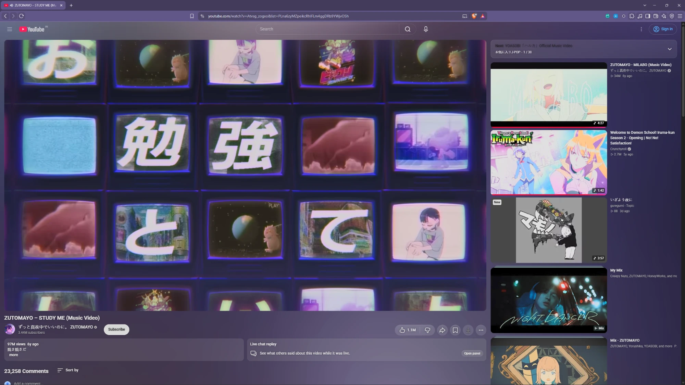
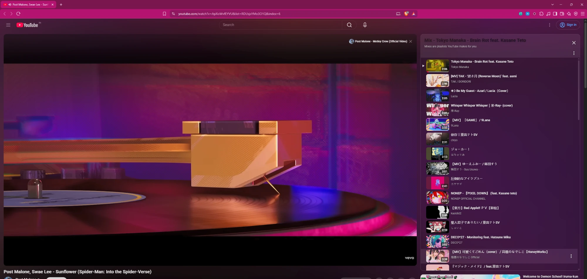
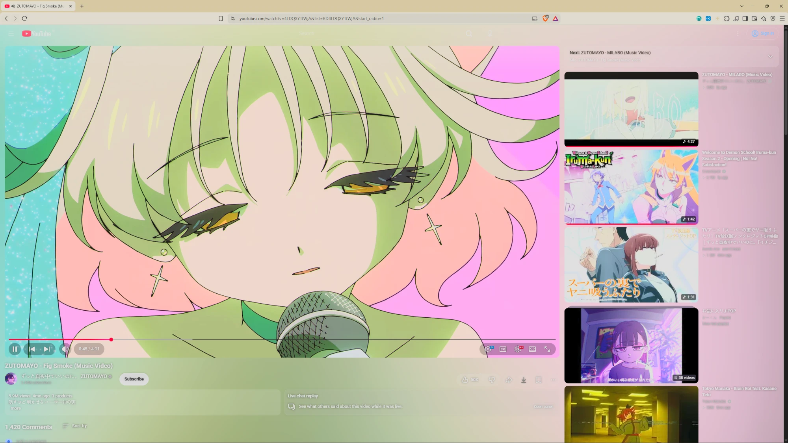
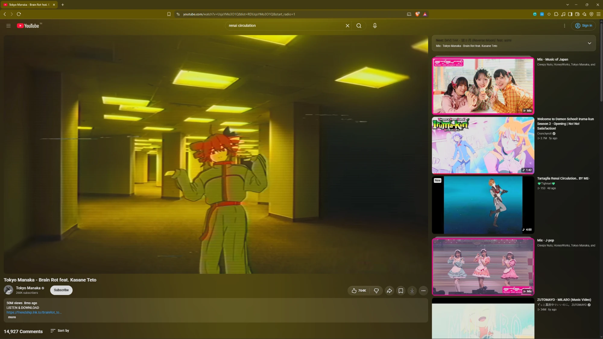

# Toolbar Glow

Makes your browser's tabs and address bar match the colour of the website you are on. On YouTube it follows the colours of the video.





<p>
  
  
</p>

Works on Brave and Chrome for Windows.

Works best together with [Ambient light for YouTube](https://chromewebstore.google.com/detail/ambient-light-for-youtube/paponcgjfojgemddooebbgniglhkajkj).

## Install

1. Click Code, then Download ZIP, and extract it.
2. Double click `install.bat` and allow the admin prompt. If Windows shows a SmartScreen warning, click More info, then Run anyway.
3. Copy one of these into your address bar:

   Brave
   ```
   brave://extensions
   ```
   Chrome
   ```
   chrome://extensions
   ```
4. Turn on Developer mode, click Load unpacked and pick the extracted folder.
5. Reload your open tabs.

If the toolbar does not change colour, click the extension icon and press Run setup.

## Settings

Click the extension icon to turn it on or off, pick YouTube or other websites, and change the glow intensity and height.

## Uninstall

Double click `uninstall.bat`, then remove the extension from your browser.

## Note

While it is on, the browser shows "Managed by your organization". This is normal and comes from the theme setting the extension uses. It goes away after uninstalling.
